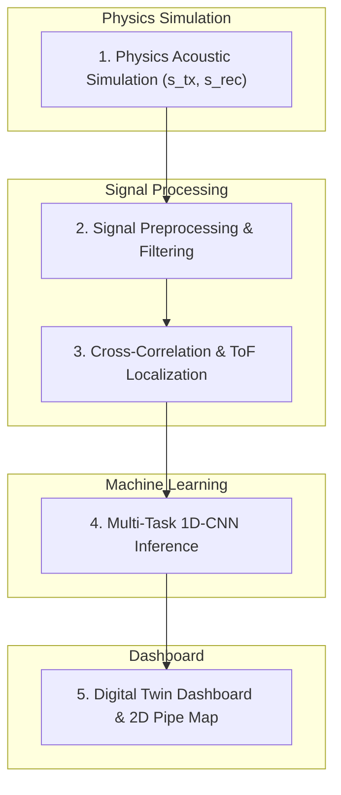

# Architecture & Data Flow: Infrasonic Sewer Clog Detection Digital Twin

## 1. System Data Flow

The digital twin processes data through five sequential stages:

### Stage Details

1. **Synthetic Acoustic Data Generation (`src/physics/`)**:
   - Generates a 10 Hz – 40 Hz linear chirp as transmitted excitation wave $s_{\text{tx}}(t)$.
   - Computes acoustic impedance $Z = \frac{\rho c}{A}$ and reflection coefficient $R = \frac{Z_2 - Z_1}{Z_2 + Z_1}$.
   - Delays the reflected wave by time $\tau = \frac{2 \cdot d}{c}$.
   - Applies exponential distance attenuation $\exp(-0.01 \cdot d)$ and Additive White Gaussian Noise (AWGN).
   - Generates the received sensor signal $s_{\text{rec}}(t)$.

2. **Signal Preprocessing & Filtering (`src/signal/`)**:
   - Applies a 4th-order zero-phase Butterworth bandpass filter (10 Hz – 40 Hz) using second-order sections.
   - Cancels direct-path transmission spillover at lag 0 via orthogonal projection.

3. **Cross-Correlation & ToF Localization (`src/signal/`)**:
   - Computes cross-correlation between received signal and reference pulse.
   - Blanks non-causal negative lags and near-field spillover.
   - Locates correlation power peak to estimate round-trip delay $\tau$ and distance $d = \frac{\tau \cdot c}{2}$.

4. **Multi-Task 1D-CNN Inference (`src/models/`)**:
   - Accepts 1D acoustic time-series tensor `(batch_size, 1, seq_len)`.
   - Extracts hierarchical temporal features using 4 Conv1D blocks with BatchNorm and MaxPool.
   - Aggregates features via AdaptiveAvgPool1d(1).
   - Classification head outputs 4 severity logits (`Clear`, `Minor`, `Moderate`, `Severe`).
   - Regression head outputs scalar blockage distance in meters.

5. **Dashboard Visualization & Risk Reporting (`src/dashboard/`)**:
   - Renders live transmitted and received time-series waveforms.
   - Plots cross-correlation matched filter power vs. distance.
   - Displays real-time KPIs (Real Distance, AI Distance, MAE, Severity Badge).
   - Draws an interactive 2D pipe layout schematic with a pinpoint marker placed at the predicted clog location.

---

## 2. Module Interfaces & Responsibilities

| Module | Primary File | Core Responsibilities | Implementation Status |
| :--- | :--- | :--- | :--- |
| **Physics** | `src/physics/acoustic_simulator.py` | Acoustic wave generation, impedance calculation, and reflection modeling | **Implemented & Verified** |
| **Signal** | `src/signal/processor.py` | Bandpass filtering, direct spillover cancellation, and cross-correlation ToF | **Implemented & Verified** |
| **Models** | `src/models/clog_cnn1d.py` | Multi-Task 1D-CNN network, dataset generator, and multi-task loss | **Implemented & Verified** |
| **Training** | `src/models/train.py` | 10-epoch training loop optimizing $\mathcal{L} = \mathcal{L}_{\text{CE}} + 0.05 \cdot \mathcal{L}_{\text{MSE}}$ | **Implemented & Verified** |
| **Evaluation** | `src/models/evaluate.py` | Accuracy, F1-score, MAE evaluation, and noise degradation benchmark | **Implemented & Verified** |
| **Dashboard**| `src/dashboard/app.py` | Streamlit interactive web UI, 2D pipe map schematic, and live charts | **Implemented & Serving** |

---

## 3. Future & Planned Enhancements
- **Field Hydrophone Data Ingestion**: Interface for reading real WAV/CSV acoustic sensor streams from deployed field units.
- **Multi-Junction Pipe Networks**: Extended acoustic graph modeling for branching sewer pipe topologies.
- **Automated Work-Order Dispatch**: Automated alerting integration for municipal work management systems.
